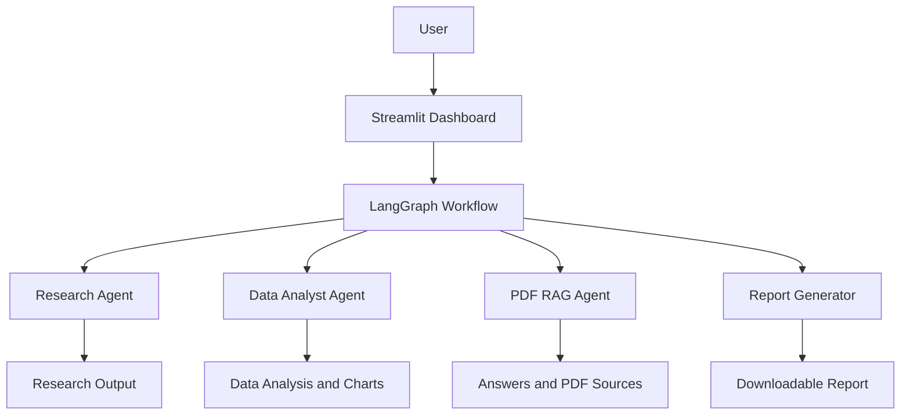

# ResearchFlow AI

**AI-Powered Research, Data Analysis, PDF Question Answering & Report Generation**

ResearchFlow AI is an intelligent research workspace built using Python, Streamlit, LangGraph, and Groq. It combines AI-powered research, CSV data analysis, PDF question answering, and automated report generation in one application.

## Features

- **Research Assistant** – Generate structured research content on different topics using AI.
- **Data Analyst** – Upload CSV files, explore datasets, view statistics, analyze questions, and generate charts.
- **PDF Question Answering** – Upload PDF documents and ask questions using Retrieval-Augmented Generation (RAG).
- **Source References** – View relevant PDF content and page references alongside answers.
- **Report Generator** – Generate downloadable reports using research and dataset analysis.
- **Interactive Dashboard** – Access all features through a Streamlit interface.

## Tech Stack

- Python
- Streamlit
- LangGraph
- LangChain
- Groq
- FAISS
- HuggingFace Sentence Transformers
- Pandas
- Matplotlib
- PyPDF

## Project Structure

```text
ResearchFlow-AI/
│
├── app.py
├── requirements.txt
├── .env
│
├── agents/
│   ├── researcher.py
│   ├── analyst.py
│   ├── rag.py
│   └── report.py
│
├── graph/
│   ├── workflow.py
│   └── __init__.py
│
├── tools/
├── documents/
├── uploads/
└── outputs/
```

## Architecture



## Installation

### 1. Clone the Repository

```bash
git clone <your-github-repository-url>
```

### 2. Navigate to the Project

```bash
cd ResearchFlow-AI
```

### 3. Create a Virtual Environment

```bash
python -m venv .venv
```

### 4. Activate the Environment

Windows:

```powershell
.venv\Scripts\activate
```

### 5. Install Dependencies

```bash
pip install -r requirements.txt
```

## Configuration

Create a `.env` file in the project root:

```env
GROQ_API_KEY=your_groq_api_key
```

Replace `your_groq_api_key` with your Groq API key.

**Important:** Never upload your `.env` file or expose your API key on GitHub.

## Run the Application

```bash
streamlit run app.py
```

The application will open in your browser.

## How to Use

### Research Assistant
1. Open Research Assistant.
2. Enter a research topic.
3. Start research.
4. View and download the generated research.

### Data Analyst
1. Open Data Analyst.
2. Upload a CSV file.
3. Explore dataset information and statistics.
4. Ask questions about your dataset.
5. Generate charts.

### PDF Question Answering
1. Open PDF Question Answering.
2. Upload a PDF document.
3. Process the document.
4. Ask questions about its content.
5. View answers and relevant source pages.

### Report Generator
1. Generate research or upload a CSV dataset.
2. Open Reports.
3. Enter a report topic.
4. Generate the report.
5. Download the generated report.

## Security

- Store API keys in environment variables.
- Keep `.env` out of version control.
- Do not commit private documents or sensitive datasets.

## Limitations

- Research responses are generated by an AI model and are not guaranteed to be factually correct.
- Research generation does not perform live web verification.
- Dataset question answering depends on the implemented analysis logic.
- PDF answers depend on document extraction and retrieval quality.

## Future Improvements

- Live web research with source citations.
- Advanced natural-language data analysis.
- More visualization options.
- Improved report formatting.
- Deployment with cloud hosting.

## Author

**Krish**

---

If you find this project useful, consider giving it a star on GitHub.